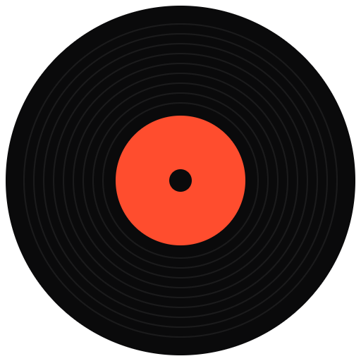
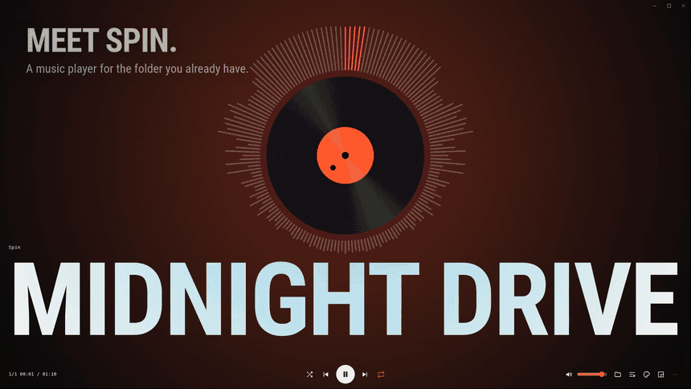
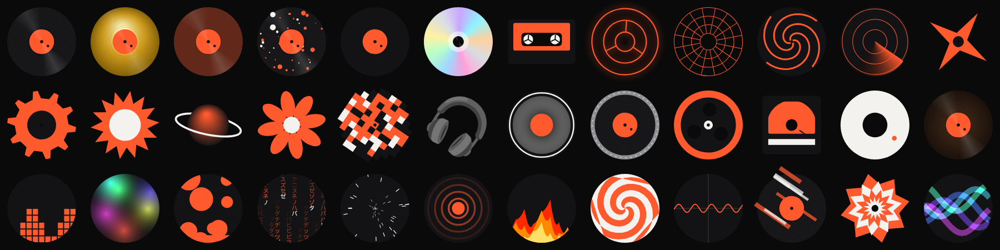
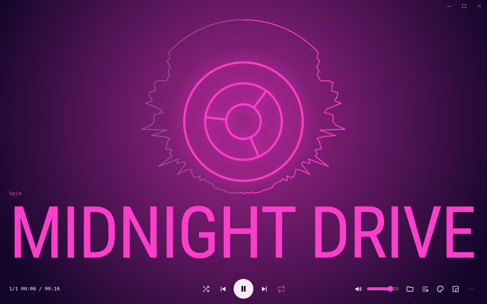
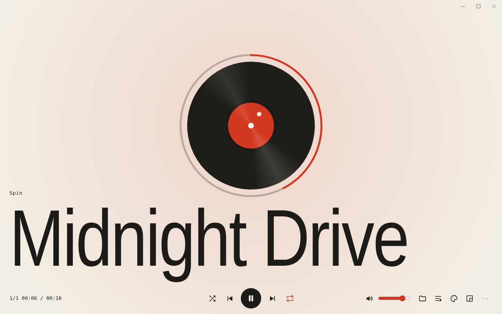
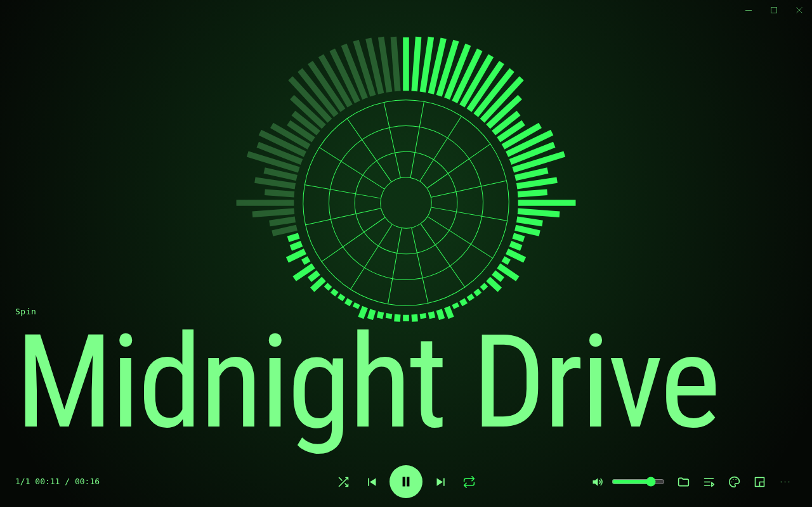
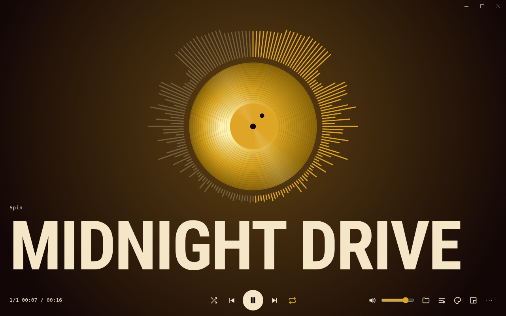
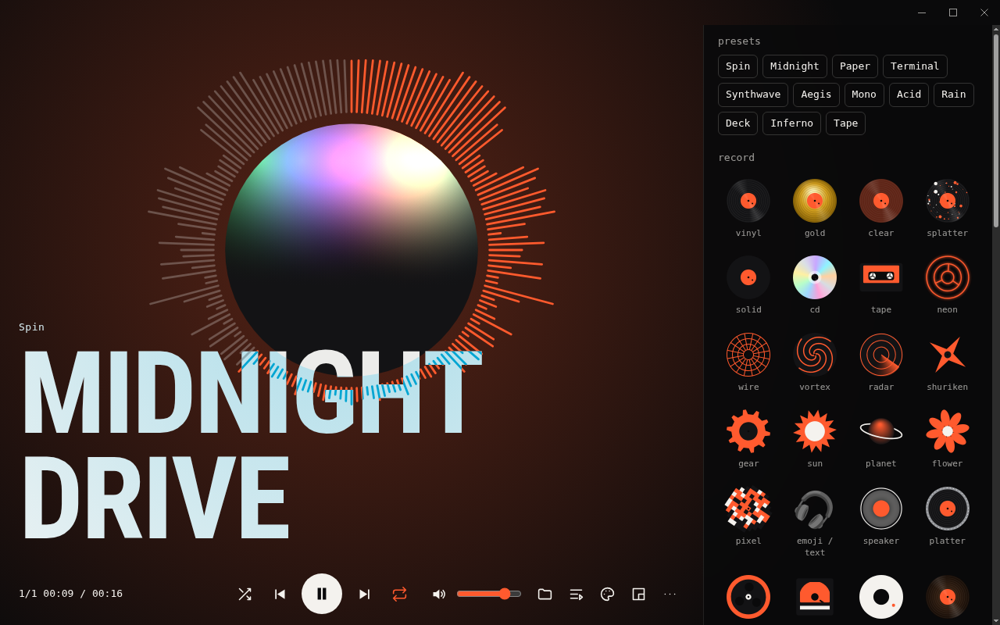
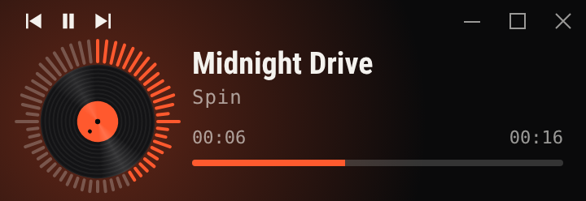

<div align="center">



# Spin

**A music player you can actually spin.**

Open the folder you already have, press play, and drag the record to move through the song.<br>
No accounts. No cloud. No library to organise.

[**Download**](../../releases) · [Watch the video](docs/spin-promo.mp4) · [Features](#what-it-does) · [Keys](#keyboard-shortcuts)

[](https://github.com/theparsakhezli/Spin/actions/workflows/ci.yml)
[](LICENSE)


<br>

<a href="docs/spin-promo.mp4"></a>

<sub>Click the preview to watch the 16-second video with sound.</sub>

</div>

## What it does

### Spin to seek

Drag the record to scrub, flick it to let it coast, and click it to pause. Let go and the audio spins back up like a real turntable.

### 37 records, or your own



Vinyl, CD, cassette, neon, and a dozen animated ones that move to the music. You can also use any emoji or text, your own image, an animated GIF or a video loop.

### Make it yours

<table>
  <tr>
    <td width="50%"></td>
    <td width="50%"></td>
  </tr>
  <tr>
    <td></td>
    <td></td>
  </tr>
</table>

Change the colours, fonts, ring shape, glow and background from a live panel beside the record. Start from 12 presets, save your own, and share them as a file. You can also import the images and colours from a Winamp skin you own.

<p align="center"></p>

### Big or small

<p align="center"></p>

Use the full view with proper play controls, or the small always-on-top widget. Switch with one click.

### It gets to know you

- **Smarter shuffle:** songs you finish come up more, and songs you skip come up less. With enough history, it also leans towards what you usually play at this hour.
- **Per-song volume:** each song remembers its own level.
- **Marks:** mark a moment you love, and the record snaps to it.
- **Stickers and wear:** put a sticker on the label. The songs you play most slowly look worn in.
- **Crates:** switch between named folders, each keeping its own place.
- **Your year:** see your hours, top songs and top artists.

### Plays nicely with games

Game mode shrinks Spin to just the record while a game has focus, with its own volume level. Global hotkeys let you pause or skip without leaving the game.

### Private by design

Spin makes no network requests of its own. Your listening history stays on your computer.

## Download

Get the latest version from the [**Releases page**](../../releases).

| System | File |
|---|---|
| **Windows** | `Spin-x.y.z-win-x64.exe` |
| **macOS (Apple silicon)** | `Spin-x.y.z-mac-arm64.dmg` |
| **macOS (Intel)** | `Spin-x.y.z-mac-x64.dmg` |
| **Debian, Ubuntu** | `Spin-x.y.z-linux-amd64.deb` |
| **Other Linux** | `Spin-x.y.z-linux-x86_64.AppImage` or `.tar.gz` |

<details>
<summary><b>Install notes for each system</b></summary>

<br>

**Windows:** the installer isn't code-signed, so SmartScreen may warn you. Choose **More info**, then **Run anyway**.

**macOS:** builds aren't notarized, because that requires a paid Apple Developer account. Drag Spin to Applications, then run:

```sh
xattr -cr /Applications/Spin.app
```

The macOS build passes automated tests but has had little real-world use, so reports are welcome.

**Debian, Ubuntu:**

```sh
sudo apt install ./Spin-*.deb
```

**AppImage:** run `chmod +x Spin-*.AppImage`, then start it. If it won't start on a recent Ubuntu, the system is blocking Chromium's sandbox, so use the `.deb` instead.

</details>

<details>
<summary><b>What works on each system</b></summary>

<br>

| Feature | Windows | macOS | Linux (X11) | Linux (Wayland) |
|---|---|---|---|---|
| Game mode from your games list | Yes | Yes | Yes | Press `g` |
| Game mode for any fullscreen app | Yes | Press `g` | Yes | Press `g` |
| Always on top | Yes | Yes | Depends on the window manager | Often ignored |
| Global hotkeys | Yes | Yes | Yes | Depends on the desktop |

Linux game detection needs `xprop`, which most X11 desktops include. The widget can only appear over games running in borderless or windowed mode.

</details>

<details>
<summary><b>Supported audio formats</b></summary>

<br>

MP3, FLAC, AAC/M4A, Ogg Vorbis, Opus, WAV and WebM. Apple Lossless (ALAC) `.m4a` files aren't supported and get skipped.

Titles and cover art come from ID3, FLAC, Vorbis and M4A tags, and WAV files can provide titles. Files with no tags use the filename (`Artist - Title.mp3`). Tracks stream from disk, so long mixes are fine.

</details>

## Keyboard shortcuts

Every main control has a button, and these shortcuts do the same things.

| Key | Action | Key | Action |
|---|---|---|---|
| `space` | Play / pause | `t` | Style panel |
| `n` / `p` | Next / previous | `e` | Widget / full view |
| `←` `→` | Seek 5 seconds | `q` | Queue |
| `↑` `↓` | Volume | `/` | Filter tracks |
| `s` | Shuffle | `c` | Crates |
| `r` | Repeat | `y` | Your year |
| `m` | Mute | `g` | Game mode |
| `b` | Mark this moment | `[` `]` | Jump between marks |
| `o` | Open a folder | `?` | All keys |

Press `,` to open `settings.json`, where you can change your name, global hotkeys and game list. Global hotkeys default to `Ctrl+Alt` on Windows and macOS, and `Ctrl+Alt+Shift` on Linux.

## Contributing

Issues and pull requests are welcome. Please run `npm test` first, and keep the main window uncluttered: new features should stay out of the way until someone wants them.

Reports from real macOS and Linux desktops are especially useful, and so are reports from real games on any system.

<details>
<summary><b>Run from source</b></summary>

<br>

Requires [Node.js](https://nodejs.org) 20 or newer.

```sh
npm ci
npm start
npm test            # end-to-end test (Linux without a display: xvfb-run -a npm test)
npm run dist        # build installers for this system
```

If you see `bad option` errors in a VS Code terminal, run `unset ELECTRON_RUN_AS_NODE` first (PowerShell: `Remove-Item Env:ELECTRON_RUN_AS_NODE`).

The player is three files, with no runtime dependencies: `index.html` (interface, audio and drawing), `main.js` (window, files and system integration) and `preload.js` (the bridge between them). `index.html` also runs on its own in Chrome or Edge, without the desktop-only features.

</details>

## License

[MIT](LICENSE). Built with [Electron](https://www.electronjs.org).

Spin isn't affiliated with Winamp, VLC or any other player, and includes none of their artwork. Only import skins you have the right to use.
